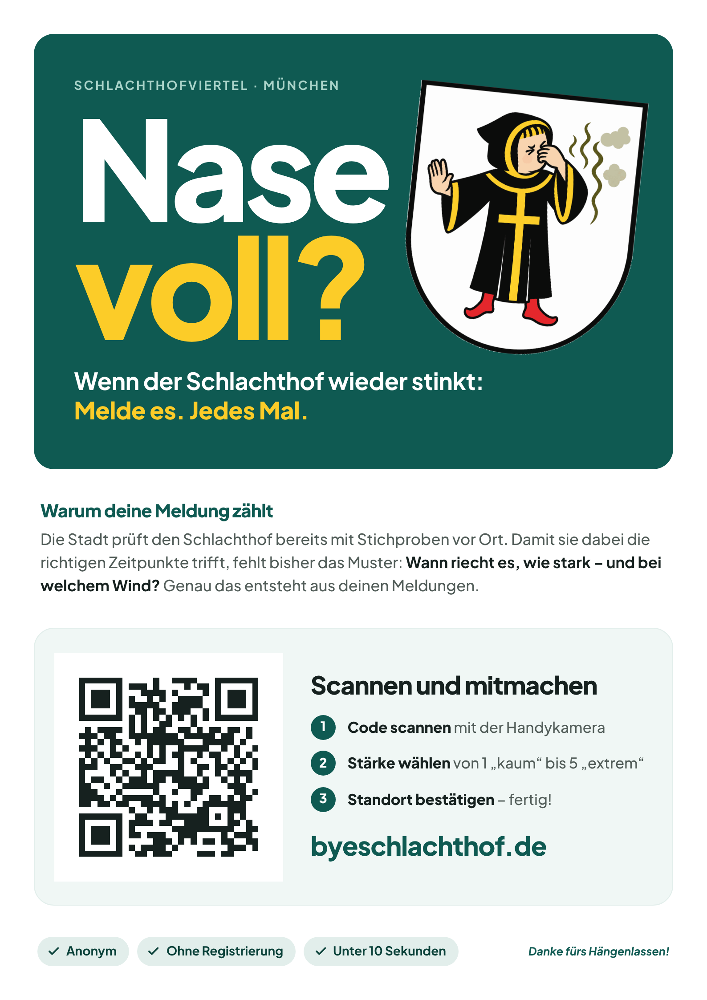
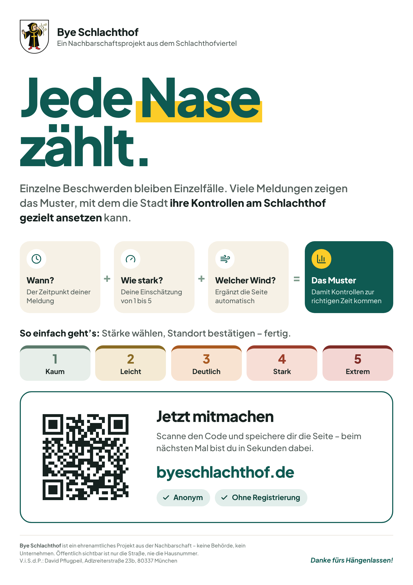
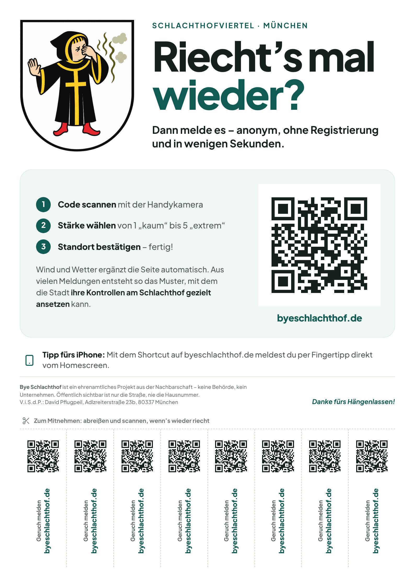

# Flyers

Three A4 flyers to hang up in the neighbourhood. Each carries a QR code to
<https://www.byeschlachthof.de>. The print-ready files are in `pdf/`.

| Flyer | Angle | File |
| --- | --- | --- |
| „Nase voll?“ | Eye-catcher: big headline, the Kindl, why reporting helps | [`pdf/nase-voll.pdf`](pdf/nase-voll.pdf) |
| „Jede Nase zählt.“ | Explains the pattern: time + strength + wind → targeted inspections | [`pdf/jede-nase-zaehlt.pdf`](pdf/jede-nase-zaehlt.pdf) |
| „Riecht’s mal wieder?“ | Tear-off flyer: eight tabs, each with its own QR code | [`pdf/abreisszettel.pdf`](pdf/abreisszettel.pdf) |

<p>
  
  
  
</p>

## Printing

- Print at **actual size** (100 %), not “fit to page”. Everything stays 10 mm
  clear of the edge, so home printers do not cut anything off.
- Colour or black and white both work. The designs keep their contrast in
  greyscale, and the QR codes decode from a greyscale print.
- The tear-off flyer needs seven cuts along the dashed lines, from the bottom
  edge up to the horizontal line.
- Outdoors, a clear sleeve keeps the paper and the QR code readable in the rain.

## What the QR code points to

The home page, not `/melden`. Most people scan while nothing smells. The home
page offers the iPhone shortcut first and has the report button right below it.
The code is version 3 with error correction level Q (about 25 % of it can be
damaged or dirty and it still scans). Every code, including those on the tabs,
was checked by decoding the rendered PDFs.

## Imprint

„Jede Nase zählt.“ and the tear-off flyer name the person responsible
(V.i.S.d.P.), the same person as in the website's imprint. „Nase voll?“
carries no imprint line. Anyone else who distributes the flyers under their
own name changes that line in the HTML files.

## Editing

The flyers are plain HTML and CSS: `nase-voll.html`, `jede-nase-zaehlt.html`
and `abreisszettel.html` share `flyer.css`, whose colours mirror
`src/app/globals.css`. After a change, render the PDFs and previews again:

```bash
npm install --no-save playwright && npx playwright install chromium   # once
npm run flyers
```

Opening an HTML file in Chrome and printing it to PDF (margins: none,
background graphics: on) gives the same result without Playwright.

`assets/` holds what the flyers embed:

- `qr.svg` and `kindl.png`, generated by `python3 scripts/generate-flyer-assets.py`
  (requires Pillow and segno). Rerun it only if the public address or the brand
  mark changes.
- `fonts/`, the static weights of Plus Jakarta Sans that the site uses, under
  the SIL Open Font License (`fonts/OFL.txt`).
